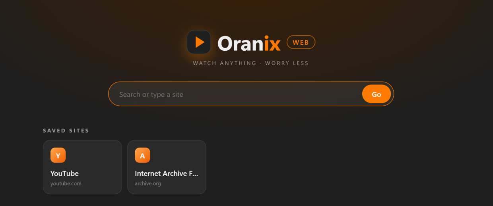

<p align="center">
  
  &nbsp;&nbsp;
  
</p>

<h1 align="center">Oranix</h1>
<p align="center"><b>Play More. Worry Less.</b><br>
A clean, fast video player and a video-first web browser — for Windows and Android.</p>

<p align="center">
  <a href="https://github.com/lazankit/oranix/releases/latest"></a>
  <a href="https://github.com/lazankit/oranix/releases"></a>
  
  <a href="LICENSE"></a>
  <a href="https://github.com/lazankit/oranix/stargazers"></a>
</p>

<p align="center">
  <a href="https://github.com/lazankit/oranix/releases/latest"><b>⬇ Download</b></a> ·
  <a href="#quick-start">Quick start</a> ·
  <a href="#features">Features</a> ·
  <a href="#build-it-yourself">Build</a> ·
  <a href="CONTRIBUTING.md">Contribute</a>
</p>

<p align="center"></p>
<p align="center"><sub>Oranix Player · <i>Big Buck Bunny</i> © Blender Foundation, <a href="https://creativecommons.org/licenses/by/3.0/">CC BY 3.0</a></sub></p>

## Quick start

| | |
|---|---|
| **Windows** | Download **[`OranixSetup.exe`](https://github.com/lazankit/oranix/releases/latest)** → run it → open *Oranix Player* or *Oranix Web* from the Start menu. |
| **Android** | Download **[`OranixWeb.apk`](https://github.com/lazankit/oranix/releases/latest)** on your phone → open it → allow "install unknown apps" once. |

No account, no telemetry, no ads.

---

Oranix is two small apps with one look:

| | **Oranix Player** | **Oranix Web** |
|---|---|---|
| For | Video files on your PC | Video on websites |
| Built on | [mpv](https://mpv.io) + [uosc](https://github.com/tomasklaen/uosc), with an Oranix skin, popups and gestures | Microsoft WebView2 (Windows) / Android WebView |
| Platforms | Windows | Windows, Android |

<p align="center"></p>

## Features

### Oranix Player (Windows)
- **Clay + glass look** in Oranix orange and charcoal, Poppins type, its own start screen.
- **Audio & Subtitles popup** — English listed first, one click to switch. **C** turns subtitles on/off (remembers your pick).
- **Quality & speed popup**, **−10 s / +10 s**, previous/next episode, time remaining always visible.
- **Touchpad gestures:** two-finger scroll on the left half = brightness, right half = volume (up to 200 %), sideways = seek.
- **Brightness tuned for OLED** — dims mid-tones so blacks stay black.
- Double-click the title bar to maximize, the video to go fullscreen. Remembers where you stopped.
- **Live editing:** change anything in its `config` folder and the open player restarts at the same second with the change.

### Oranix Web (Windows + Android)
- **The Oranix player bar on any web video** (YouTube and most sites), right where the video sits on the page — or open it in the full Oranix window.
- **Ad shield:** blocks ad and tracking networks, pop-ups, pop-unders, redirect hijacks and fake overlays; strips YouTube's ad schedule and auto-skips any ad that slips through.
- **Smart next/previous:** finds playlists, "next episode" buttons and next-page links; Netflix-style *Up next* card.
- **Quality picker** where the site's player allows it (YouTube, JW Player).
- **Video detector** when a page has several videos — pick the one to watch.
- Saved sites and history on the Oranix start page.
- **Android extras:** double-tap left/right = −10/+10 s, hold for 2× speed, swipe to seek / brightness / volume, pinch to zoom-fill tall screens, landscape edge-to-edge fullscreen, themed icon, 120 Hz.

## Install

Download from the **[latest release](https://github.com/lazankit/oranix/releases/latest)**:

- **Windows:** `OranixSetup.exe` — installs Oranix Player and Oranix Web for your user (no admin needed), adds Start menu entries and an uninstaller. Oranix Player uses mpv; if it isn't installed, Oranix Player offers to install it (`winget install shinchiro.mpv`).
- **Android 8+:** `OranixWeb.apk` — copy to your phone and open it (allow "install unknown apps" once).

## Keys (Oranix Player)

| Key | Action | Key | Action |
|---|---|---|---|
| Space / K | Play / pause | ← / → | −5 s / +5 s (Shift: 30 s) |
| ↑ / ↓ | Volume | N / M | Brightness down / up |
| C | Subtitles on/off | S / A | Audio & subtitles popup |
| X | Quality & speed | F / Enter | Fullscreen |
| > / < | Next / previous episode | ? | All shortcuts |

Oranix Web uses the same keys while a video is playing, plus **O** for the full Oranix window and **Esc** to go back.

## Build it yourself

Everything builds with free tools; no Visual Studio needed.

```
Oranix-src/
├─ player/      Oranix Player: launcher (C#) + mpv config, scripts, fonts
├─ web/         Oranix Web for Windows (C#) + the shared web player (oranix-player.js) and start page
├─ android/     Oranix Web for Android (Java, no Gradle)
├─ installer/   Inno Setup script
├─ build.ps1    Builds both Windows apps (+ installer with -Installer)
└─ live.ps1     Pushes edits into an installed copy instantly
```

**Windows** — needs Windows 10/11 (its built-in .NET Framework 4.8 C# compiler) and, for the installer, [Inno Setup 6](https://jrsoftware.org/isinfo.php):

```powershell
.\build.ps1 -Installer      # -> installer\Output\OranixSetup.exe
```

**Android** — needs JDK 17 and the Android SDK (`platforms;android-34`, `build-tools;34.0.0`) in `%USERPROFILE%\android-tools`:

```powershell
.\android\build.ps1         # -> android\out\OranixWeb.apk (signed with a key it creates on first run)
```

**Live editing** — after installing, edit files here and push them into the running apps:

```powershell
.\live.ps1   # Oranix Web reloads the page; Oranix Player restarts at the same second
```

## Good to know

- Oranix Web's ad shield is for your own browsing. Please respect the sites you visit and the creators who depend on them.
- Oranix doesn't collect anything. Saved sites and history stay on your device.

## Contributing

Ideas, bug reports and pull requests are welcome — see **[CONTRIBUTING.md](CONTRIBUTING.md)**. Looking for a place to start? Try an issue labelled [**good first issue**](https://github.com/lazankit/oranix/labels/good%20first%20issue). Please follow the [Code of Conduct](CODE_OF_CONDUCT.md).

If Oranix is useful to you, a ⭐ helps others find it.

## Credits & license

Oranix is released under the [MIT License](LICENSE). It stands on the shoulders of [mpv](https://mpv.io), [uosc](https://github.com/tomasklaen/uosc), [Poppins](https://github.com/itfoundry/Poppins), Microsoft WebView2 and Android WebView — see [THIRD-PARTY-NOTICES.md](THIRD-PARTY-NOTICES.md) for their licenses.
