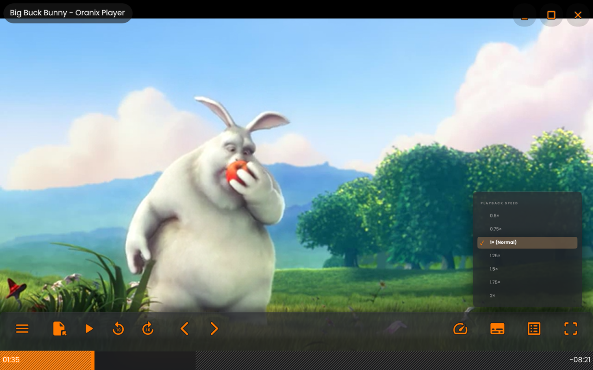

<p align="center">
  
  &nbsp;&nbsp;
  
</p>

<h1 align="center">Oranix</h1>
<p align="center"><b>One clean player bar for every video — on websites and on your own files.</b></p>

<p align="center">
  <a href="https://github.com/lazankit/oranix/releases/latest"></a>
  <a href="https://github.com/lazankit/oranix/releases"></a>
  
  <a href="LICENSE"></a>
  <a href="https://github.com/lazankit/oranix/stargazers"></a>
</p>

<p align="center">
  <a href="https://github.com/lazankit/oranix/releases/latest"><b>⬇ Download</b></a> ·
  <a href="#whats-in-the-box">What's in the box</a> ·
  <a href="#features">Features</a> ·
  <a href="#build-it-yourself">Build</a> ·
  <a href="CONTRIBUTING.md">Contribute</a>
</p>

Most video sites ship their own controls — different on every site, mouse-only, often cluttered with ads. Oranix replaces them with one consistent, keyboard- and gesture-friendly bar: the same keys, the same subtitle and speed menus, the same swipe gestures, wherever the video is.
<p align="center"></p>
<p align="center"><sub><i>Big Buck Bunny</i> © Blender Foundation, <a href="https://creativecommons.org/licenses/by/3.0/">CC BY 3.0</a></sub></p>

## What's in the box

| | What it is | Built on |
|---|---|---|
| **Oranix for Chrome** | Browser extension: the Oranix bar on web videos + an ad/tracker blocklist | `oranix-player.js` (Oranix's own) — Chrome, Edge, Brave, Vivaldi, Opera |
| **Oranix Web** | Small video-first browser with the same bar, a pop-up/redirect shield and a start page | WebView2 (Windows), Android WebView |
| **Oranix Player** | Video player for files on your PC | [libmpv](https://mpv.io) for playback and [uosc](https://github.com/tomasklaen/uosc) for the control bar, plus Oranix's own window, popups, gestures and theme |

Oranix Player is built with [mpv](https://mpv.io) and [uosc](https://github.com/tomasklaen/uosc) — see [THIRD-PARTY-NOTICES.md](THIRD-PARTY-NOTICES.md).

## Quick start

| | |
|---|---|
| **Chrome / Edge / Brave** (Windows, macOS, Linux, ChromeOS) | Download **`oranix-chrome.zip`** → unzip → `chrome://extensions` → **Developer mode** → **Load unpacked** → pick the folder. |
| **Windows** (x64 & ARM64) | Download **`OranixSetup.exe`** → run it → open *Oranix Player* or *Oranix Web*. Everything is included — no separate mpv install. |
| **Android** (all phones) | Download **`OranixWeb.apk`** on your phone → open it → allow "install unknown apps" once. |
| **Linux** (any CPU) | Install mpv, download **`oranix-player-linux.tar.gz`** → `tar xzf oranix-player-linux.tar.gz && bash oranix-player/install.sh` |

All downloads are on the **[latest release](https://github.com/lazankit/oranix/releases/latest)**. No account, no telemetry.
## Features

### Oranix Player (Windows; Linux as an mpv setup)
- **Clay + glass look** in Oranix orange and charcoal, Poppins type, its own start screen.
- **Audio & Subtitles popup** — English listed first, one click to switch. **C** turns subtitles on/off (remembers your pick).
- **Quality & speed popup**, **−10 s / +10 s**, previous/next episode, time remaining always visible.
- **Touchpad gestures:** two-finger scroll on the left half = brightness, right half = volume (up to 200 %), sideways = seek.
- **Brightness tuned for OLED** — dims mid-tones so blacks stay black.
- Double-click the title bar to maximize, the video to go fullscreen. Remembers where you stopped.
- **Live editing (Windows):** change anything in its `config` folder and the open player restarts at the same second with the change.
- **Windows:** self-contained — libmpv (x64 + ARM64) is included, nothing else to install.
- **Linux:** not a separate app (yet) — `install.sh` sets up the same theme, popups, keys and gestures on your distro's mpv.

### Oranix Web and Oranix for Chrome
- **The Oranix player bar on any web video** (YouTube and most sites), right where the video sits on the page — or open it in the full Oranix window.
- **Ad shield:** blocks ad and tracking networks, pop-ups, pop-unders, redirect hijacks and fake overlays; strips YouTube's ad schedule and auto-skips any ad that slips through.
- **Smart next/previous:** finds playlists, "next episode" buttons and next-page links; Netflix-style *Up next* card.
- **Quality picker** where the site's player allows it (YouTube, JW Player).
- **Video detector** when a page has several videos — pick the one to watch.
- Saved sites and history on the Oranix start page.
- **Android extras:** double-tap left/right = −10/+10 s, hold for 2× speed, swipe to seek / brightness / volume, pinch to zoom-fill tall screens, landscape edge-to-edge fullscreen, themed icon, 120 Hz.

## Install

Download from the **[latest release](https://github.com/lazankit/oranix/releases/latest)**:

- **Windows 10/11, x64 or ARM64:** `OranixSetup.exe` — one installer for both kinds of PC (the apps run natively on Snapdragon/Windows-on-ARM laptops). Installs Oranix Player (with libmpv bundled) and Oranix Web for your user (no admin needed), adds Start menu entries and an uninstaller.
- **Linux (x86_64, ARM64, …):** `oranix-player-linux.tar.gz` — Oranix Player on top of your distro's mpv. Install mpv (`sudo apt install mpv`, `dnf`, `pacman` or Flatpak), then run `bash install.sh` from the unpacked folder. Adds an app-menu entry and an `oranix-player` command; `bash uninstall.sh` removes it.
- **Android 8+, every phone and tablet:** `OranixWeb.apk` — copy to your phone and open it (allow "install unknown apps" once).
- **Chrome, Edge, Brave, Vivaldi, Opera** (Windows, macOS, Linux, ChromeOS): `oranix-chrome.zip` — *Oranix for Chrome* puts the Oranix player bar on web videos and blocks ad and tracker networks in your normal browser. Unzip, open `chrome://extensions`, enable **Developer mode**, click **Load unpacked** and choose the folder.

## Keys (Oranix Player)

| Key | Action | Key | Action |
|---|---|---|---|
| Space / K | Play / pause | ← / → | −5 s / +5 s (Shift: 30 s) |
| ↑ / ↓ | Volume | N / M | Brightness down / up |
| C | Subtitles on/off | S / A | Audio & subtitles popup |
| X | Quality & speed | F / Enter | Fullscreen |
| > / < | Next / previous episode | ? | All shortcuts |

Oranix Web uses the same keys while a video is playing, plus **O** for the full Oranix window and **Esc** to go back.

## Build it yourself

Everything builds with free tools; no Visual Studio needed.

```
Oranix-src/
├─ player/      Oranix Player: launcher (C#) + mpv config, scripts, fonts
├─ web/         Oranix Web for Windows (C#) + the shared web player (oranix-player.js) and start page
├─ android/     Oranix Web for Android (Java, no Gradle)
├─ chrome/      Oranix for Chrome (Manifest V3 extension: shared player bar + blocklist)
├─ linux/       Oranix Player for Linux (install.sh around mpv)
├─ installer/   Inno Setup script
├─ build.ps1    Builds both Windows apps, AnyCPU (+ installer with -Installer)
└─ live.ps1     Pushes edits into an installed copy instantly
```

**Chrome extension** and **Linux package** — no extra tools needed:

```powershell
.\chrome\build.ps1          # -> chrome\out\oranix-chrome\ (load unpacked) + oranix-chrome.zip
.\linux\build.ps1           # -> linux\out\oranix-player-linux.tar.gz
```

**Windows** — needs Windows 10/11 (its built-in .NET Framework 4.8 C# compiler) and, for the installer, [Inno Setup 6](https://jrsoftware.org/isinfo.php):

```powershell
.\build.ps1 -Installer      # -> installer\Output\OranixSetup.exe
```

**Android** — needs JDK 17 and the Android SDK (`platforms;android-34`, `build-tools;34.0.0`) in `%USERPROFILE%\android-tools`:

```powershell
.\android\build.ps1         # -> android\out\OranixWeb.apk (signed with a key it creates on first run)
```

**Live editing** — after installing, edit files here and push them into the running apps:

```powershell
.\live.ps1   # Oranix Web reloads the page; Oranix Player restarts at the same second
```

## Privacy

Oranix doesn't collect anything. Saved sites and history stay on your device.

## Contributing

Ideas, bug reports and pull requests are welcome — see **[CONTRIBUTING.md](CONTRIBUTING.md)**. Looking for a place to start? Try an issue labelled [**good first issue**](https://github.com/lazankit/oranix/labels/good%20first%20issue). Please follow the [Code of Conduct](CODE_OF_CONDUCT.md).

If Oranix is useful to you, a ⭐ helps others find it.

## Credits & license

Oranix is released under the [MIT License](LICENSE). It stands on the shoulders of [mpv](https://mpv.io), [uosc](https://github.com/tomasklaen/uosc), [Poppins](https://github.com/itfoundry/Poppins), Microsoft WebView2 and Android WebView — see [THIRD-PARTY-NOTICES.md](THIRD-PARTY-NOTICES.md) for their licenses.
